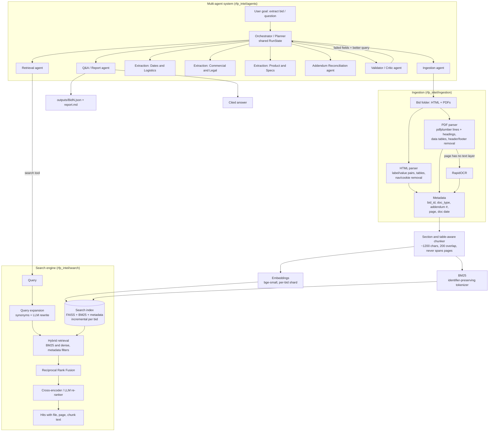
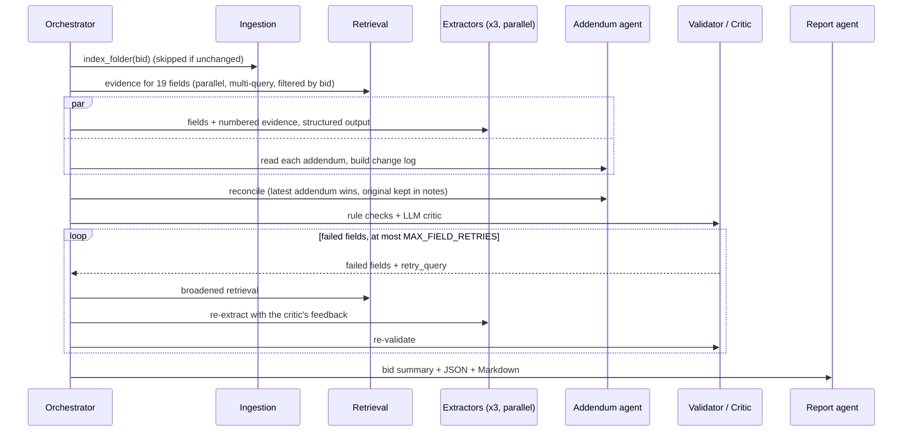

# RFP Intelligence Platform

A retrieval-augmented system that reads bid / RFP folders (portal HTML pages, RFP PDFs, addenda, spec sheets, affidavits), makes them searchable with a **hybrid RAG search engine**, and runs a **multi-agent pipeline** that produces a cited, validated JSON record per bid and answers free-form questions with citations.

* Works on any bid folder with a similar structure. Nothing is hard-coded to the two sample bids: document types, addendum numbers and dates are inferred, and field definitions and search queries are generic procurement vocabulary.
* Every value and every answer is grounded in retrieved passages, with file and page citations. When something is missing, the system says `"Not found in documents"` instead of guessing.

---

## 1. Quick start

```bash
python -m venv .venv && source .venv/bin/activate
pip install -r requirements.txt
cp .env.example .env            # LLM=open (OpenRouter, add OPENROUTER_API_KEY) or LLM=gpt (OpenAI, add OPENAI_API_KEY)

python main.py --bid ./data/Bid1 --bid ./data/Bid2   # one command: index + extract -> outputs/Bid1.json, Bid2.json
```

Other modes:

| Command | What it does |
|---|---|
| `python main.py index data/Bid1 data/Bid2` | Parse, chunk, embed and index (incremental per bid) |
| `python main.py search "bid bond" --bid-id Bid1 --doc-type rfp` | Hybrid search with filters, printed with citations (`--json`, `--mode bm25\|dense`) |
| `python main.py ask "What is the submission deadline for Bid1 after all addendums?"` | Q&A mode (multi-agent, cited answer) |
| `python main.py extract data/Bid3` | Extraction mode for a new, unseen bid folder |
| `python main.py qa-log eval/qa_questions.txt` | Batch Q&A, written to `outputs/qa_log.md` and `.json` |
| `python main.py eval` | Retrieval evaluation table, written to `eval/retrieval_results.md` |
| `python main.py serve` | REST API on `:8000` (OpenAPI docs at `/docs`) |
| `streamlit run rfp_intel/ui/streamlit_app.py` | Web UI: search, chat, extraction viewer |
| `docker compose up` | API on `:8000` and UI on `:8501` (indexes the sample bids first) |
| `pytest -q` | Unit tests (parsing, search, agents with a scripted LLM) |

REST endpoints: `POST /index`, `GET /search?q=...&bid_id=...&doc_type=...&top_k=5&mode=hybrid`, `POST /ask`, `POST /extract`, `GET /bids`, `GET /health`.

All model names, keys and knobs come from environment variables (`.env.example` documents every one). No secrets are in code.

---

## 2. Architecture



### Extraction run (one bid)



---

## 3. Design decisions

### 3.1 Ingestion (Part A)

* **PDF**: `pdfplumber` gives line-level text with font info, so headings can be detected (bold, all-caps, or numbered like `1.2 Terms`). `y_tolerance=6` keeps spec-sheet rows ("description … SKU") on one line. PyMuPDF does a fast pre-check, and pages with no text layer (scans or outlined glyphs, such as the W-9 pages in Bid1) skip the slow layout pass and go to **OCR** (RapidOCR, ONNX, no system dependencies).
* **Tables**: a detected table is kept as a table only if it has at least 2 rows with at least 2 filled cells and short cells. Otherwise it is a layout box and is read as text. Tables are rendered as `cell | cell` rows, so the bid-information grid of the PORFP and the price schedule of the Dallas RFP stay row-aligned.
* **Cleaning**: running headers and footers are lines repeated in the top or bottom 4 lines of at least 50% of pages, compared with digits collapsed. The first occurrence is kept, so the RFP title still appears once. The cleaner also removes page numbers and dot leaders, de-hyphenates words split across lines, joins wrapped lines into paragraphs while keeping bullets and numbered items, and normalizes unicode and whitespace.
* **HTML**: noise (nav, header, footer, cookie banners, menus) is removed, but never a wrapper that holds most of the page. Label/value fields are read from common markup (`*-label` + sibling, `dt/dd`, 2-column tables), which turns the portal page into clean `Closing Date: 07/09/2024 03:00 PM EDT` facts.
* **Metadata** on every document and chunk: `bid_id`, `file_name`, `doc_type` (`bid_page`, `rfp`, `addendum`, `specs`, `affidavit`, `form`, `other`), `addendum_number`, `page_number`, `doc_date`. These are inferred from file names and first-page content with generic rules. For addenda the PDF's own date is used, because their body quotes the new due date.
* **Failures** are logged per document (`warnings` in the index catalog) and never stop the run: corrupt files, empty pages, OCR fallback, table-extraction errors.

### 3.2 Chunking

* Chunks are **section-aware**. Headings start a new chunk and become `section` metadata, and the section is prepended to the text that is embedded and BM25-indexed. A short chunk under the heading "LENGTH OF CONTRACT" then still matches a query about the contract term.
* Chunks are **table-aware**. Tables and key/value groups are never cut mid-row. Large tables are split by rows with the header row repeated.
* Prose is packed by paragraph up to **~1200 characters (~250-300 tokens)**, with at most 1800, plus a **~200-character sentence-aligned overlap** inside the same section.
* **Chunks never span pages**, so every citation is an exact page.
* Why ~1200 characters: RFP facts are short and local (a date line, a bond clause, one spec bullet list). Small chunks keep BM25 precise and keep extraction prompts compact (6-9 passages per field). They are still large enough to hold a full spec tier or a full Q&A item from an addendum. Much larger chunks would mix several unrelated requirements (boilerplate-heavy RFP pages) and dilute both dense and lexical scores. All sizes are configurable (`CHUNK_*`) and can be compared with `python main.py eval`.

### 3.3 Search engine (Part B)

* **Hybrid retrieval**: BM25 (`rank_bm25`) plus dense cosine similarity (FAISS `IndexFlatIP`, numpy fallback). The BM25 tokenizer keeps identifiers whole *and* indexes their parts (`JA-207652` gives `ja-207652`, `ja`, `207652`; `210-BLYZ`; `WD22TB4`). This matters for bid, part and model numbers.
* **Fusion**: Reciprocal Rank Fusion (k=60). It is scale-free, so BM25 and cosine scores don't need calibration.
* **Query understanding**: a domain synonym map (deadline → due date / closing date / solicitation due; bond → bid security / surety; …) creates query variants. Each variant is searched and the results are fused with RRF, so expansion adds recall without diluting the original query. The Retrieval agent can also ask the fast LLM for rewrites.
* **Re-ranking**: the top 25 fused candidates are re-ranked with a cross-encoder (`ms-marco-MiniLM-L-6-v2`), or with an LLM listwise scorer (`RERANKER_BACKEND=llm`).
* **Metadata filtering** on `bid_id`, `doc_type`, `addendum_number`, `file_name`, `page_number` (single values or lists), for example `--bid-id Bid2 --doc-type specs`.
* **Citations**: every hit returns file, page, chunk id, doc type, addendum number, section and the chunk text.
* **Incremental indexing**: each bid is a shard on disk (`chunks.jsonl`, `vectors.npy`, `docs.json` with a content fingerprint). Indexing a new folder embeds only that folder. Re-indexing an unchanged folder is a no-op. Shards are swapped atomically. The BM25 and FAISS indexes in memory are rebuilt from shards on load, which is cheap compared with embedding.
* **Embedding model**: `BAAI/bge-small-en-v1.5` (384-d, CPU-fast, strong on retrieval benchmarks, uses a query instruction prefix). `openai` is also supported. Two offline fallbacks exist for machines that can't download weights: `spacy` (averaged static word vectors) and `hash` (hashed n-grams with a fixed random projection). The fallbacks are chosen automatically and logged.

### 3.4 Multi-agent system (Part C)

**Framework choice: a small custom asyncio orchestrator, no agent framework.** The workflow is a known DAG with a bounded feedback loop, not open-ended tool use. Plain `async` code with Pydantic messages is easy to read, test, trace and explain, needs no extra dependencies, and runs specialists concurrently with `asyncio.gather`. LangGraph would add a graph DSL without adding capability here. Agents use the search engine as a **tool** and only ever see retrieved passages, never whole documents.

| Agent | Responsibility | Output (Pydantic) |
|---|---|---|
| **Orchestrator / Planner** (`orchestrator.py`) | Builds the plan, runs steps, routes failed fields back for retrieval and extraction (max `MAX_FIELD_RETRIES`), decides when it is done, writes outputs | `RunState.plan`, final record |
| **Ingestion** | Detects type, parses, cleans, adds metadata, triggers (incremental) indexing | `IndexReport` |
| **Retrieval / Search** | Multi-query search per field (spec queries, synonyms, LLM rewrites, critic's retry query), bid and doc-type filters, rerank, RRF de-dup across queries | `Evidence[]` with citations |
| **Extraction** (3 specialists: *Dates & Logistics*, *Commercial & Legal*, *Product & Specs*) | Fill their fields from numbered evidence only, cite evidence ids, return null when absent | `ExtractionLLM` → `FieldResult` |
| **Addendum Reconciliation** | Reads every addendum in order, builds a change log mapped to fields, applies the latest change and keeps the original value in notes | `AddendumChange[]` |
| **Validator / Critic** | Rule checks (citation present and real, identifiers, numbers and dates present in cited text, term overlap, format of dates and contacts), then an LLM critic per field; failures go back to the Orchestrator with a better query; adjusts confidence | `FieldValidation` |
| **Q&A / Report** | Routes a question to bids and sub-queries (comparisons get one sub-query per bid), answers with inline `[E#]` citations, writes the bid summary, JSON and Markdown | `AnswerLLM`, record |

* **Shared state**: `RunState` holds the plan, evidence per field, draft fields, the addendum change log, validation results, retry counts, every agent-to-agent message, errors and the final output. It is saved to `outputs/state/<bid>_<run>.json`.
* **Feedback loop**: a field fails if its value has no valid citation (guardrail), a rule check fails, or the critic marks it unsupported. The orchestrator re-retrieves with the critic's `retry_query` plus broadened queries and more passages, re-extracts only the failed fields with the rejection reason in the prompt, re-applies addendum changes and re-validates. Retries are bounded.
* **Parallelism**: field retrieval runs concurrently, and the 3 specialists plus the addendum analysis run concurrently, limited by `LLM_CONCURRENCY`.
* **Structured outputs**: every LLM call returns a Pydantic model. Anthropic uses native structured outputs (`messages.parse`). OpenAI-compatible providers use JSON mode plus a schema. JSON repair and validation-retry cover models that drift.
* **Guardrails**: the prompts require answering only from evidence and returning null or `"Not found in documents"`. In code, an uncited value is rejected, an uncited Q&A answer becomes `"Not found in documents"`, and evidence ids are checked against the passages that were actually retrieved.
* **Error handling**: timeouts, transient API errors and bad JSON are retried with backoff. Authentication errors fail fast. A failed agent degrades only its own fields (`status: failed` with the reason) and the rest of the pipeline continues. Empty retrieval returns `not_found` without an LLM call.
* **Observability**: `outputs/traces/<run>.jsonl` holds one event per step: the plan, each search tool call (query, filters, hits, latency), each LLM call (model, prompt, structured output, tokens in and out, latency, cache hit), retries, validation and the final summary. Run totals (LLM calls, tokens, estimated USD cost) are added to the output JSON under `run`.
* **Semantic cache (bonus)**: identical LLM requests are served from `.cache/llm`, so re-runs and repeated questions cost nothing.
* **LLM switch**: `LLM=open` uses OpenRouter and `LLM=gpt` uses OpenAI (`OPENAI_MODEL`, default `gpt-4o-mini`, temperature 0). The Streamlit sidebar lets each user pick GPT or OpenRouter and paste their own API key; the key stays in that browser session and is never written to disk, and an empty field falls back to the key in `.env`.
* **Models**: by default `LLM=open` uses OpenRouter's OpenAI-compatible API (`https://openrouter.ai/api/v1`, key in `OPENROUTER_API_KEY`) with the free `nvidia/nemotron-3.5-super-vl:free` (change it with `OPENROUTER_MODEL`), reasoning on (`LLM_THINKING=true`), `temperature=1`, `top_p=0.95`, `seed=42`. Structured output uses JSON mode plus the JSON-schema prompt and JSON repair. Free OpenRouter models are rate-limited, so keep `LLM_CONCURRENCY` low; 429s are retried with backoff. `LLM_PROVIDER=nvidia` (NVIDIA API catalog, `NVIDIA_API_KEY`), `anthropic` (Claude, native structured outputs, `LLM_EFFORT`, refusal fallback), `openai` and `ollama` are still supported.

### 3.5 Prompts

The prompts live next to the agents: `GROUNDING_RULES` in `agents/base.py`, specialist system prompts in `agents/extraction.py`, `addendum.py`, `validator.py` and `report.py`. Each field's description, preferred doc types, search queries, "doesn't apply" value and format instructions are data in `agents/fields.py`. Adapting to a new field means adding one `FieldSpec`.

---

## 4. Retrieval evaluation (Part B.4)

`eval/retrieval_questions.jsonl` has **30 question → expected-passage pairs** (16 for Bid1, 14 for Bid2) covering dates, addendum changes, submission, bonds, terms, contacts, cooperative contracts, spec tables, SKUs and affidavits. A hit is relevant if it comes from the expected file and contains one of the expected answer phrases. This labelling stays valid when chunk sizes change. Metrics are Recall@1/3/5/10, MRR@10 and nDCG@10, with every query filtered to its bid. Run `python main.py eval`.

**Results from the build environment** (no internet access to model hubs, so the offline `spacy` word-vector fallback replaced bge-small, and no cross-encoder was available):

| config | Recall@1 | Recall@3 | Recall@5 | Recall@10 | MRR@10 | nDCG@10 |
|---|---|---|---|---|---|---|
| bm25-only | 0.633 | 0.933 | 0.933 | 1.0 | 0.764 | 0.825 |
| dense-only (static word vectors) | 0.267 | 0.433 | 0.467 | 0.667 | 0.377 | 0.441 |
| hybrid (RRF) | 0.567 | 0.767 | 0.8 | 0.933 | 0.68 | 0.722 |
| hybrid + query expansion | 0.533 | 0.767 | 0.767 | 0.867 | 0.653 | 0.69 |

What these numbers show:
* **BM25 is strong on RFPs.** Questions reuse document vocabulary, and exact identifiers (`#E20P4600040`, `210-BLYZ`, `060B5400007`) need lexical matching. The identifier-aware tokenizer finds every target within the top 10.
* With a **weak dense model, RRF fusion lowers precision** compared with BM25 alone, because noisy dense ranks are given the same vote. Dense retrieval is only worth fusing when the embedding model is good. That is why the default is `bge-small` plus a cross-encoder re-ranker. The CI workflow (`.github/workflows/ci.yml`) runs on GitHub, downloads both models, and produces the full table including the **hybrid + expansion + rerank** row. To reproduce locally: `pip install -r requirements.txt && python main.py index data/Bid1 data/Bid2 && python main.py eval`.

---

## 5. Outputs (deliverables)

| Deliverable | Location |
|---|---|
| JSON per bid (value, sources, confidence, notes, addendum changes, validation) | `outputs/Bid1.json`, `outputs/Bid2.json` (+ `_report.md`) |
| Retrieval evaluation report | `eval/retrieval_questions.jsonl`, `eval/retrieval_results.md/json` |
| Sample Q&A log (14 questions) | `eval/qa_questions.txt` → `outputs/qa_log.md` |
| Agent trace of an extraction run | `outputs/traces/extract_Bid1_<run>.jsonl` |

Generate them with an LLM key configured:

```bash
python main.py --bid data/Bid1 --bid data/Bid2
python main.py qa-log eval/qa_questions.txt
```

Output format (per field):

```json
"Due Date": {
  "value": "2024-07-09 14:00 CST",
  "sources": [{"file": "Addendum 2 RFP JA-207652 ....pdf", "page": 1}],
  "confidence": 0.93,
  "notes": "Updated by Addendum 2 (original: 2024-06-27 14:00 CST)."
}
```

---

## 6. Project structure

```
rfp_intel/
  config.py              env-driven settings
  ingestion/             html_parser, pdf_parser (+OCR), cleaning, metadata, loader, models
  search/                chunker, embeddings, index (incremental shards), query (expansion), rerank, engine
  agents/                orchestrator (+ingestion agent), retrieval, extraction, addendum, validator, report (Q&A), fields, schemas
  llm/client.py          Anthropic / OpenAI-compatible / scripted clients, cache, retries, JSON repair
  observability/         JSONL tracer, token and cost accounting
  api/app.py             FastAPI
  ui/streamlit_app.py    Streamlit search, chat and extraction viewer
  evaluation.py          Recall@k / MRR / nDCG
  cli.py                 Typer CLI (main.py)
eval/                    question sets and results
tests/                   parsing, search and agent tests (no network or API key needed)
data/Bid1, data/Bid2     sample bids
```

## 7. Assumptions and known limitations

* Each sub-folder is one bid, and its folder name is the `bid_id`.
* `doc_type` rules use file-name and first-page cues common to US public-sector bids. Unusual naming falls back to `other`, which is still searchable.
* Time zones are reported as written in the winning source. Bid1's addendum says "2:00 PM CST" for a July deadline (strictly CDT), and the portal shows the same instant as 03:00 PM EDT.
* OCR is line-based. Multi-column scanned pages (the W-9 instructions in Bid1) are read across columns. That is acceptable for search, but not for layout-faithful extraction.
* The BM25 index is rebuilt in memory from shards on load. That is fine for hundreds of bids. For much larger corpora, swap in a persistent lexical index (Tantivy or OpenSearch). The engine interface stays the same.
* The LLM critic can be over-strict on paraphrased values. Such fields keep their value but are flagged with lower confidence and `VALIDATION FAILED` notes rather than being dropped.
